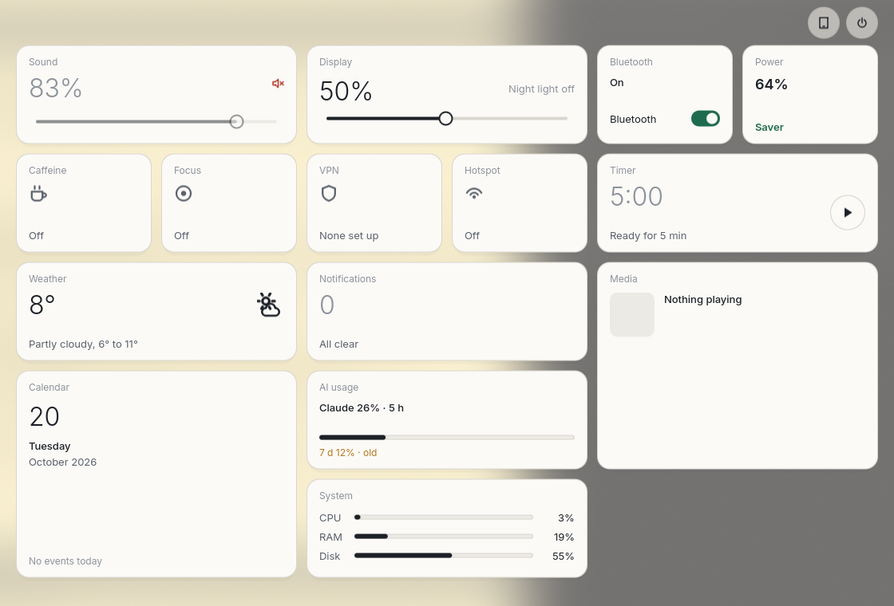
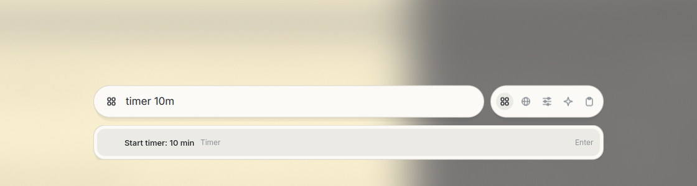

# shell.

A desktop shell for Fedora and Hyprland, built with [Quickshell](https://quickshell.org) (QML). Light, quiet, made
for a 2-in-1 laptop: everything works with keyboard, mouse and touch. Technical name: `aptus`.

Status: usable, still changing. Plan and decisions: [PHASES.md](PHASES.md).





## What is in it

- **Bar** with workspaces, window title, status icons, clock; dropdowns for sound, network, Bluetooth, battery, night light, calendar.
- **Control center** (blurred overlay with tiles): sound, display, network, Bluetooth, power profile, caffeine, focus, VPN, hotspot, capture, timer, weather, media, calendar, system monitor.
- **Launcher** with five modes: apps, calculator and system actions (`wifi off`, `timer 10m`, `lock screen`), web search (optional suggestions), settings, AI (docked chat panel for command-line AI tools), clipboard history.
- **Settings app** with draft, save, a 15 second confirmation and an external watchdog that restores the old file if the shell dies.
- **Lock screen** (PAM), **greeter** for greetd, idle policy: lock after 5 minutes, screen off after 10. **Never suspend or hibernate.**
- **Touch and tablet mode:** edge swipes, bar hides in tablet mode, screen follows the orientation sensor, built-in on-screen keyboard.
- **Wallpaper** drawn by the shell, with a picker; **power menu** (lock, log out, restart, shut down).

## Requirements

Fedora, Hyprland 0.56+ (Lua config), Quickshell 0.3.2+, plus the packages in `packages/aptus-dnf.txt` (grouped: required, session,
backup, optional). `bin/aptus-packages` reads that list and only prints; it never installs:

```sh
bin/aptus-packages check                              # per group: all installed, or what is missing
bin/aptus-packages command required session backup   # the sudo dnf command for what is missing
```

## Install

```sh
./install.sh --dry-run        # show what it would do
./install.sh                  # installs missing packages (asks, sudo dnf), links the config, adds the Hyprland block (asks first, makes a backup)
./install.sh --copr           # also offer the COPR lionheartp/Hyprland for packages Fedora does not have (asks first)
./install.sh --greeter        # optional: replace the login screen (asks, backs up /etc/greetd/config.toml)
./install.sh --uninstall      # remove the links and the Hyprland block, put back the files they replaced (asks)
./install.sh --uninstall-greeter
```

`--yes` answers the questions with yes except the COPR, which needs `--copr`. Packages are never removed by the uninstall.

aptus is meant as the main shell. With the user's `shell-switch` it starts at login; a second shell (Noctalia) stays installed
as a backup and takes over if aptus does not come up. The window look (a little transparency, strong blur) is in `hypr/aptus-look.lua`;
the installer copies it to `~/.local/state/aptus/hyprland-look.lua` again whenever it changed.

Start with `aptus`. Send commands to the running shell with `aptus msg <command>`, for example
`aptus msg panel-toggle control-center`, `aptus msg session lock`, `aptus msg tablet-toggle`.

## Colours for the apps

<!-- TODO(phase 7, themes): rewrite this section: eight themes (light, dark, ocean, forest, dusk, sand, sky, wallpaper) plus auto, Super+T opens the picker, setting appearance.theme, wallpaper fit and login screen picture, aptus-theme-apps --theme, aptus-wallpaper-theme. -->
Light or dark: **Super+T** switches and remembers it. The setting is `appearance.colorMode` (`light`, `dark`, `auto`; `auto` is dark while the night light runs), also in the settings app. The shell fades over 300 ms and repaints all apps in the background (`aptus-theme-apps --mode <light|dark> --all --quiet`). `aptus msg theme-mode-set dark` sets it from a script.

`aptus-theme-apps` paints the programs around the shell with the same palette (`theme/tokens.json`, light or dark, templates in `theme/apps`):

```
aptus-theme-apps                    # kitty, ghostty, GTK, Qt, btop, zathura, gsettings (light)
aptus-theme-apps --mode dark --all  # everything, dark
aptus-theme-apps --only starship,zen --dry-run
```

`--all` adds Starship (`~/.config/starship/aptus.toml`, selected by fish through `STARSHIP_CONFIG`), fish, Neovim (`colorscheme aptus`), yazi, fastfetch (`~/.config/fastfetch/aptus-config.jsonc`, used by the `fastfetch` alias in fish), cava, window borders, hyprlock, Zen and Thunderbird (`userChrome.css`, `userContent.css`; start Thunderbird once so it has a profile) and a Spicetify theme (set `light` or `dark` and applied by the script; restart Spotify to see it). Zen and Thunderbird follow the system colour scheme, which the script sets with gsettings; restart the browser once after the first run. Replaced files are kept as `NAME.before-aptus`; nothing is installed.

## Keys (defaults)

| Key | Action |
|---|---|
| Mod+Space or Mod+D | launcher |
| Mod+A / Mod+Shift+B / Mod+Shift+C | AI / web / clipboard mode |
| Mod+L | lock |
| Mod+X | power menu |
| Mod+W | wallpaper picker |

## Safety

- If the shell dies while the screen is locked, it stays locked. Switch to a console with Ctrl+Alt+F3, log in and start the shell again.
- The greeter installer keeps your old greetd config as `config.toml.before-aptus`; the way back is in the installer output.
- A settings change that is not confirmed within 15 seconds is reverted.

## Layout

`shell/` QML shell, `greeter/` login screen, `config/` defaults, `theme/` design values, `bin/` helper scripts, `hypr/` Hyprland snippets.
Lint: `./aptus-lint.sh` (qmllint, target 0 warnings).

## License

MIT, see [LICENSE](LICENSE).
